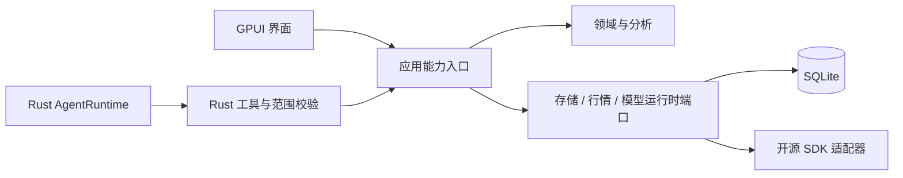

# 统一能力与适配接口

版本 0.4 · 2026-11-08 · 公共类型与 M1–M2 实现边界见第 7 节，尚非稳定 SDK。金融口径见 [金融规则](financial-engine.md)，AI 状态见 [上下文管理](context-state-management.md)。

## 1. 单一调用路径



进程内 Rust trait/应用服务为业务入口；跨进程仅在需要处编码 DTO。首版不引入 HTTP 微服务或通用插件总线。MCP 是未来传输适配候选，不定义另一套业务工具。

## 2. 能力目录与公共信封

每项能力声明稳定 `capability_id`、`schema_version`、输入/输出 schema、effect（query/command）、owner、所需范围和取消语义。注册的工具目录从应用能力投影；首版只投影查询白名单，不能把所有 command 自动暴露给模型。

```text
CallContext
  request_id, library_id, actor_kind, run_id?, generation?,
  scope_ref, expected_revision?, deadline, cancellation

ResultEnvelope<T>
  schema_version, request_id, result_id, value,
  scope_snapshot, source_versions, quality,
  missing_inputs[], evidence_refs[], warnings[]

ErrorEnvelope
  schema_version, request_id, code, retryable,
  safe_message, details_allowlist, correlation_id
```

`scope_ref` 由宿主签发并在宿主解析，不让模型提交任意账户集合替代授权。模型与工具回调的 run/generation/request_id 必须匹配活跃实例；generation 是生命周期防陈旧标识，不宣称密码学鉴权。

错误码至少覆盖 `INVALID_ARGUMENT`、`SCOPE_DENIED`、`REVISION_CONFLICT`、`MISSING_INPUT`、`UNSUPPORTED_CAPABILITY`、`PROVIDER_UNAVAILABLE`、`RATE_LIMITED`、`CANCELLED`、`INTERRUPTED`、`PROTOCOL_ERROR`。错误保留是否可重试；不返回秘密或原始响应正文。

金额/数量/费率为十进制字符串；时间为 UTC RFC3339、区间 `[start,end)`；实体 ID 不依赖显示名称。无值与零不同。scope 中始终显式记录本位币/报表币种、成员快照和数据/计算版本。

## 3. 主要端口

| 端口 | 最小契约 | 不允许的旁路 |
| --- | --- | --- |
| LedgerService | 预览、提交、冲销替代、对账、快照与损益 | UI/AI 直接写分录或自行算收益 |
| MarketDataProvider | 能力、标的、日线/公司行动/FX、游标及来源时间 | 用余额或调整行情改写持仓 |
| JournalService | 保存/版本、检索、关联、ChartContext | 无范围查询整个笔记库 |
| ChartAdapter | 加载范围、窗口/指标/标记、选择、导入/导出上下文 | 自行维护指标算法和未来可见性 |
| AgentRuntime | start、prompt、cancel、checkpoint/close、resume、能力检测与事件 | 模型框架直接访问业务库 |
| AnalysisToolGateway | 列白名单、schema 校验、查询与证据回执 | 任意 SQL、shell、文件和真实交易工具 |

ModelClient 负责类型化请求与协议事件，AgentRuntime 负责工具循环和上下文状态；两个端口不混用。具体字段与两协议合同见 [Rust 模型客户端](rust-model-client.md)。

## 4. Rust 模型与后台作业边界

模型接入在 Rust 进程内通过 ModelClient 端口与 Tokio 异步流完成，不另建模型工作进程或公共 HTTP 服务。Responses 与 Chat Completions 适配转换为公共事件，完整工具请求再交 Rust 网关。配置/模型/协议/能力明确绑定 run，错误、取消和迟到结果不得绕过宿主状态机。

事件公共头为 run_id/generation/sequence/type；至少涵盖运行开始、文本增量、完整工具请求/回执、压缩开始/结束、用量、完成、错误、取消。UI 无法接续时从 SQLite checkpoint 重建，不宣称网络流恰好一次。预算、流大小和重试限制以模型客户端合同为正本。

按 [D-22](../decisions/confirmed-decisions.md)，全项目 100% 纯 Rust 实现，不启动 Python 子进程。数据拉取、指标计算与后续策略评估均在 Rust 进程内通过受控后台作业（`JobId`、deadline、取消令牌与步数/资源上限）执行；截断 JSON/UTF-8、超大响应、限流背压、超时和任务故障均转为结构化错误，模型密钥不注入数据或策略模块。

## 5. 幂等、取消与兼容

业务 command 用 request_id 与输入摘要绑定，同 ID 不同输入拒绝；回执和变更同事务。query 的重试必须绑定相同快照；业务未实现某旧修订查询时明确拒绝，不能暗换 latest。

取消先设置宿主状态并停止接纳新的工具调用，再取消 Rust 网络/编排任务；期限内未退出标 interrupted 并回收可释放资源。已提交业务不能撤销冒充未发生。晚到事件按 generation 丢弃，已观察的费用保留；没有成功终态的报告不得标成功。

新增可选字段向后兼容；不兼容 schema 主版本升级并有迁移/拒绝路径。数据库 schema、工具 schema、金融计算版本、数据修订和运行代次分开管理。

## 6. 必需契约验证

相同 scope/版本的 UI 查询与 AI 工具数值、质量和证据一致；未知工具、伪造范围、陈旧 generation 和失效引用均被拒绝。覆盖重复请求、并发更正、取消晚到响应、断开恢复、错误映射、金额跨语言无损和协议版本不匹配。首轮场景见路线中的 AC 与各阶段（M1–M5）验收用例。

## 7. M1–M2 实际接口实现

M1–M2 的消费者包括 CLI、GPUI 桌面工作台（`delta-desktop`）与只读 AI 复盘工具网关（`AnalysisToolGateway`）。`AppHost` 在单写者宿主线程上持有 `AppService`，对外提供带范围的查询契约（`AnalysisScope` → `ResultEnvelope<T>` + `EvidenceRef` + `m2-ledger-1`）与统一能力目录（`CapabilityCatalog`）。AI 只读工具严格投影自能力目录的 7 项只读子集（`scope.describe`、`report.period_breakdown`、`ledger.list_transactions`、`ledger.holdings_lots`、`reconcile.list_issues`、`data.quality_summary`、`journal.search_notes`），同一范围与版本下桌面 UI 查询与 AI 工具调用执行同一函数并产生逐字段一致的 `ResultEnvelope`（`M2-A-01`）。

`AnalysisScope` 实际包含 `target`、解析后的 `resolved_accounts`、`start_date`、`as_of_date`、`report_currency`、`dataset_version`、`ledger_revision`、`journal_revision`、`visible_until`、`include_notes` 与 `versions_frozen`。第一次解析把 latest 与账户成员解析成明确快照；冻结后，`dataset_version=0` 表示尚无行情，空账户集表示没有获准账户，不能因新数据或新账户自动扩大。当前不支持的旧账本修订明确拒绝；笔记内容与权限指纹变化使冻结范围失效。日期查询同时执行期间与截止校验，工具参数不能覆盖宿主范围。

AI 每个 run 从 SQLite Backup API 取得一致的私有内存副本，全部工具读取同一副本；持久化转录仍通过 live 宿主短事务写入，不在网络等待期间占用 live SQLite 事务。工具明细超过预算时，投影返回 `Partial`、截断原因与独立 `result_id`，仅保留实际返回对象的证据和数值；完整 UI 查询与工具投影的差异必须可见。

笔记查询同时验证账户 owner、关联事件日期、图表锚点和 `review_date`；普通历史复盘按复盘日期筛选，`visible_until` 还限制实际保存时刻。候选扫描上限 10,000、返回上限 100，达到上限显式给出缺项警告。保存要求期望修订匹配，冲突返回 `REVISION_CONFLICT`；首次 scoped 保存将账户与复盘日期链接和笔记修订一并提交。

同一已发布数据版本只能读取其可见 raw 行情/FX/actions；未知或未封存版本拒绝（`UNPUBLISHED_DATASET`），陈旧 generation 拒绝（`STALE_GENERATION`），未知或越权账户拒绝（`SCOPE_DENIED`）。新 import/held resolution 固定事件 FX，更正保留历史 journal 与冲销引用并将旧保存报告标为 `stale`。公开应用会话必须持库锁，后台同步共用 lease，取消与事务发布互斥。

长作业句柄保留独立宿主引用和写入 lease。取消回执表示已接受取消，`worker_finished` 才表示后台资源已释放；同步进度报告真实 phase 与 prepared/published 数量。取消与 deadline 会中断在途 provider future 和重试等待，不能只在两次 HTTP 请求之间检查。

`FixtureAccountProvider::from_recorded_response` 只解析声明的合成 OKX/Binance 原生 data 数组，不发网络请求；`ModelClient` 在 `delta-model` 中实现 `openai-responses` 与 `openai-chat-completions` 双协议 SSE 适配，经本地回环服务完成全套协议与流式边界验证（`M2-K03` / `M2-A-13`），真实在线模型服务由用户按 `ACT-01` 配置后启用。
