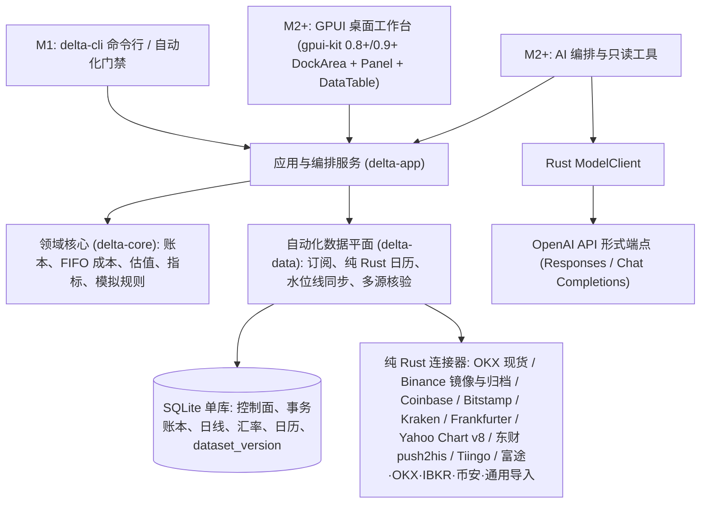

# DELTA 系统架构设计

版本 1.4 · 2026-11-12 · 按 [D-20 ～ D-23](../decisions/confirmed-decisions.md) 与 [ADR-0003](../decisions/0003-first-round-stack.md) 重构为“100% 纯 Rust 实现、金融数据平面优先、核心与桌面 UI 解耦”的本地优先架构；定案 M1 SQLite 单库、实测修正的纯 Rust 连接器路由（优先覆盖用户主力 **富途牛牛 + 欧易 OKX** 及常用老虎、IBKR、长桥、嘉信、东方财富、币安）与 `delta-app` 异步边界（M1 计划第 3 节（计划已归档于 Git 历史，结果见 [M1 阶段报告](../evidence/2026-11-08-m1-stage-report.md)））。公共能力详见 [统一接口](integration-contracts.md)，Rust 会话所有权详见 [上下文状态](context-state-management.md)。

## 1. 架构目标与决策

1. **全项目 100% 纯 Rust 实现（D-22）**：M1～M6 不引入任何运行期 Python 子进程或外部脚本解释器。行情/汇率/公司行动连接器、交易日历、技术指标、十进制账本、应用编排、CLI、M2 GPUI 桌面工作台、AI 模型客户端、M4 训练与 M5 受控策略引擎全部在单一纯 Rust 代码库与二进制中完成。
2. **金融数据底座先行（Data-First，D-20）**：M1 优先交付可自动增量同步、多源交叉核验的本地金融数据平面（`delta-data`）、十进制账本核心（`delta-core`）与命令行工具（`delta-cli`），不绑定任何桌面 GUI 框架。
3. **单一真相与 UI 分阶段衔接（D-21）**：M1 领域核心与数据平面不耦合 GUI；M2 桌面端直接采用长桥最新 **`gpui-kit`（`0.8.x` / `0.9.x`）官方 `DockArea` + `DockSkin` + `Panel` + `DataTable` + `Card` 面板体系**，在同一个 Rust 进程内通过 `delta-app` 的同步命令/查询与作业句柄调用服务与不可变数据快照（`dataset_version`）。

## 2. 逻辑架构



## 3. 模块职责与依赖边界

| 模块 | 负责 | 不负责 |
| --- | --- | --- |
| `delta-core`（领域核心） | Decimal 金额/数量、事件校验、平衡分录、FIFO 成本批次、转账配对、公司行动、估值与损益分解、技术指标、模拟撮合与受控策略规则 | 网络请求、SQL、文件读写、窗口渲染 |
| `delta-data`（自动化数据平面） | 标的与别名解析、纯 Rust 交易日历、行情/汇率/公司行动多源拉取、水位线增量同步、数据质量诊断、SQLite 读写（`dataset_partition` 存储抽象） | 定义脱离 `delta-core` 的第二套损益口径 |
| `delta-app`（应用服务） | 用例命令/查询、权限范围（`AnalysisScope`）、后台作业句柄与代次（超时/取消/错误隔离）、证据回执、AI 只读工具网关；私有持有异步运行时 | 将各市场私有格式写死在视图层；对外暴露 `tokio`/`reqwest` 类型 |
| `delta-cli`（M1 交互与门禁入口） | 建库、账户/CSV/IBKR 导入、一键行情与汇率增量同步、对账与损益报告输出、备份恢复、导出/删除、阶段自动化门禁 `verify-stage` | 包含独立业务逻辑 |
| 桌面视图（M2+） | 基于 `gpui-kit` 官方 `DockArea`/`Panel`/`DataTable`/`Card` 的面板布局、焦点、K 线视口窗口切片交互 | 直接写 SQL、解析供应商原始报文、自行计算手续费或指标 |

## 4. 内置自动化数据平面设计（告别外部手动维护）

为解决“美股与加密数据如何与应用结合、避免用户手动维护脚本与 CSV”的核心问题，`delta-data` 采用纯 Rust 四段式自动化流水线：

### 4.1 账本与自选驱动的自动订阅（Auto-Subscription）

- 当用户导入券商/交易所账单（如富途牛牛/IBKR 出现 `NASDAQ:AAPL`、`NYSE:SPY`，欧易/币安出现 `OKX:BTC/USDT`、`BINANCE:BTC/USDT`）或添加自选标的时，系统自动在 SQLite `instrument` 与 `instrument_alias` 表注册标准标的身份，并自动推导所需计价资产与汇率对（如 `USDT/USD`、`USDC/USD`、`USD/HKD`、`USD/CNY`）。
- 自动建立各数据源与平台符号映射：例如标准身份 `NASDAQ:AAPL` 自动关联富途的 `US.AAPL`、Tiingo/Yahoo/IBKR/嘉信/老虎的 `AAPL`、东方财富的 `105.AAPL`、长桥的 `AAPL.US`。

### 4.2 交易日历感知的水位线增量同步（Watermark Incremental Sync）

- SQLite `sync_checkpoint` 按 `(provider, resource_kind, resource_key)` 唯一记录游标与 `last_committed_at`：行情的 `resource_key` 由 `instrument_id + timeframe + adjustment` 组成，汇率为货币对，账户资源为 `connection_id + 资源类型`（字段正本见 [数据模型](data-model.md#4-导入与同步)）。游标与该页数据在同一事务提交。
- 触发时机：CLI `delta sync`、应用启动后台检查、用户手动点击“刷新数据”或导入新交易后自动触发。
- 纯 Rust 日历感知：同步前先查询 `calendar_session`（由 `chrono` + `chrono-tz` `America/New_York` 规则与内置版本化特殊闭市表生成的 `XNYS`/`XNAS` 美股日历，含节假日、13:00 ET 半日市与冬夏令时；加密现货为 `CRYPTO_24_7` UTC 日切），只拉取水位线之后且已闭合的交易时段，避免在周末/休市日无效轮询或把未闭合当日 K 线当作终态日线。

### 4.3 多源路由、降级与交叉核验（Multi-Provider Fallback & Cross-Check）

```text
MarketDataProvider
  capabilities()                 # 支持市场、周期、原始/复权、拆股/分红、是否需 Key、限流配额、terms_class
  resolve_instruments(query)     # 标的搜索与跨源别名映射
  fetch_bars(request, cursor)    # 日线/周期 OHLCV（声明来源口径 raw / split_adjusted / total_return_adjusted；规范存储为 raw）
  fetch_corporate_actions(req)   # 拆股 ratio、现金分红 amount、ex_date、pay_date
  fetch_fx_rates(request)        # 法币与稳定币汇率序列
  fetch_calendar_sessions(req)   # 交易日、开收盘 UTC、半日市标识
```

- **美股与 ETF 路由（纯 Rust HTTP）**：
  - **配置免费 Token 时**：Rust 直连 **Tiingo REST** 为主（原始 OHLCV、复权 OHLCV、`divCash`、`splitFactor`），**Yahoo Finance Chart v8** 核验；扩展层可加 **Alpaca Market Data REST**（`/v1/corporate-actions`）。
  - **零配置免 Key 路径**：Rust 直连 **Yahoo Finance Chart v8**（`query1.finance.yahoo.com/v8/finance/chart/{symbol}?interval=1d&events=div,split`）为主（获取 `splits`、`dividends` 事件与**拆股调整后的** OHLCV、`adjclose`；原始价按 M1 计划 S-08（计划已归档于 Git 历史，结果见 [M1 阶段报告](../evidence/2026-11-08-m1-stage-report.md)） 以累计拆股因子还原），Rust 直连**东方财富美股日线接口**（`push2his.eastmoney.com/api/qt/stock/kline/get`，`secid=105.AAPL` 等，`fqt=0` 原始价、`fqt=1/2` 复权）核验。当两源收盘价或复权比例在某交易日出现超阈值跳变而缺少对应 `corporate_action` 记录时，自动生成 `data_quality_issue`，将区间标记为 `partial/warning`，绝不静默输出错误收益率。
- **加密现货与稳定币路由（纯 Rust HTTP）**：
  - **公共行情（完全免 Key，覆盖用户两大主力场所）**：① **欧易（OKX）公开现货 REST**（`www.okx.com/api/v5/market/candles` 与 `history-candles`，`bar=1Dutc` 原生对齐 UTC 日切，仅提交 `confirm="1"` 已完结 K 线）；② **币安（Binance）公开行情镜像** `data-api.binance.vision`（增量）与 `data.binance.vision` 归档（回填，校验 `.CHECKSUM` SHA-256）。美国网络出口下 `api.binance.com` 返回 HTTP 451，不作为数据源。多场所通用连接（官方 Rust `ccxt` crate）属于扩展层。
  - **稳定币独立定价**：`USDT/USD` 取 Coinbase Exchange 日线（主）与 Bitstamp（核验）；`USDC/USD` 取 Bitstamp（主）与 Kraken（核验，公开 OHLC 仅最近 720 根）；写入 `fx_rate`，满足 `FR-LED-02` 与 `AC-06`（不假设稳定币恒等于 1 USD）。
- **法币汇率路由**：默认从 **Frankfurter（ECB 参考汇率）** 免 Key 拉取 `USD/CNY`、`USD/HKD`、`EUR/USD` 等工作日汇率；非发布日按 [金融规则](financial-engine.md) 的 `carried_forward` 规则使用。

### 4.4 SQLite 单库存储与快照版本（M1）

- **原始留痕**：保留导入 CSV 原始行与数据源响应正文（按内容哈希寻址，纳入备份清单），支持审计与重放。
- **规范化层**：SQLite 保存事务账本、标的字典、交易日历、公司行动、汇率、日线 `bar`、水位线与 `dataset_version` / `dataset_partition` 清单。`dataset_partition.location_kind` 保留存储类型抽象，M1 仅为 `sqlite`；Parquet/DuckDB 在 M5 批量扫描或实测性能不足时经 `OSS-10` 接入，不改变上层查询契约。
- **不可变 `dataset_version`**：每次增量同步事务提交后生成新的 `dataset_version`（含 `manifest_hash`、覆盖范围与质量等级）；版本是清单而非行情副本，`bar` 修订以有效版本区间保存，同步回看重叠窗口检出修订（M1 计划 S-09）。账本估值、图表窗口、训练回放（带 `visible_until` 截断）和 AI 问答均显式绑定 `dataset_version`，保证跨模块结果 100% 一致。

## 5. 并发、异步、容错与恢复模型

- **SQLite 单写多读**：公开应用会话持资料库独占锁，后台 worker 共用该锁 lease；SQLite 写事务串行化，开启 `WAL` 与 `FOREIGN KEY`；金额/数量用规范化十进制文本存储并在 Rust `Decimal` 中聚合，禁用 SQL `REAL` 求和。
- **异步边界与后台作业隔离（AC-16）**：`delta-core` 纯同步无 IO；`delta-data` 内部使用 `tokio` + `reqwest`；`delta-app` 私有持有运行时，对外只提供同步命令/查询与后台作业句柄（`JobId`、进度与取消经标准库通道或回调 trait），不暴露 `tokio`/`reqwest` 类型或 `async fn`。任何数据拉取或后续 M5 策略评估作业均绑定超时（deadline）、取消令牌与步数/资源上限；作业超时、取消或触发故障时由宿主安全中止并转为结构化错误（`PROVIDER_UNAVAILABLE` / `CANCELLED` / `INTERRUPTED`），主程序保持可用且不会把失败作业标为成功（AC-16）。M2 GPUI 自带执行器，可在 UI 线程直接调用；CLI 同样复用该接口。
- **一致性备份与恢复**：资料库目录即应用数据根（正式版 `%LOCALAPPDATA%\delta`、开发版 `%LOCALAPPDATA%\delta-dev`，见 [安装与数据位置](../dev-rules/data-and-security.md#install-and-data-locations)），包含 `manifest.json`、`delta.sqlite`、`raw/`（若原始响应正文存于文件）、`imports/`、`attachments/` 与 `backups/`。数据库使用 SQLite Backup API 创建一致性快照，恢复时先在独立新目录完整校验清单哈希、外键与引用后再原子切换（AC-09）。

## 6. M1 已实现边界

上文能力目录是完整产品逻辑接口。M1 使用具名 Rust Provider 方法与 capabilities，`delta-app/src/sync.rs` 承担真实编排；未建立泛化 MarketDataProvider trait、AI 工具网关或桌面宿主。实际应用接口是 AppService 同步命令/查询与 JobId，不把 Tokio 类型暴露给消费者。

同步按一个 savepoint 完成数据、水位线、质量诊断、订阅和版本发布。发布与取消共用状态锁；取消先发生则回滚，提交后保留成功。超时 worker 可能等待当前有界 HTTP 请求结束，其 lease 在退出前继续阻止另一个进程写库，不能以 UI 终态假装资源已立即释放。

原始报文内容寻址；schema 3 固定事件 FX、保留 journal 修订、封存 dataset_publication。报告使用一次加载的历史输入逐日重放，绑定 `m1-ledger-3`、币种、账户和 cutoff。备份递归包含 raw/imports/attachments/settings，恢复在 staging 校验数据库身份/哈希/外键后发布，拒绝非空目标；导出也是 coherent read snapshot + staging，8 CSV 成功后发布清单。

M1 的 AccountProvider 是离线录制实现：输入为 OKX/Binance 原生 data 数组的合成记录，规范化成交、余额和已完成充提；真实只读账户 API/鉴权/分页在线同步见 LOOP-03。所有开发数据目的路径（含备份/恢复/导出/删除）校验实际构建通道，source/dev 不能伪装 release。

## 7. 安装身份、生命周期与更新（M3）

- **身份**：构建期 `DELTA_IDENTITY` 决定 AppId、显示名、可执行文件名、互斥量、控制管道与 AppUserModelID（`delta-app/src/identity.rs`）；版本由 Git 标签推算并经 `DELTA_VERSION` 注入，build-info、`VERSIONINFO` 与设置页“关于”读取同一值（`version.rs`）。源码构建没有安装身份，不注册单实例与控制管道。
- **单实例与控制管道**（`instance.rs`）：已安装身份启动时创建命名互斥量 `<身份>-instance`（同时是安装器的 `AppMutex`）；第二个进程只经管道发送 `focus` 后退出。`\\.\pipe\<身份>-control` 只有一个实例、拒绝远程客户端，并逐连接核对客户端会话与用户 SID；管道线程把命令交给 UI 线程（`delta-desktop/src/lifecycle.rs`），60 s 内无应答回执 `busy`。
- **保存后退出**：`quit-for-update` 与“应用更新”走同一序列：检查忙碌（进行中的同步作业或 AI 复盘）→ 自动保存未保存的笔记（保存失败回执 `save-failed`）→ 保存布局 → 回执 `ok` 并附带重启参数 → 退出。控制请求遇忙碌直接回执 `busy`；用户发起的更新遇忙碌显示确认，确认后先取消同步与 AI 再继续。
- **更新**（`update.rs`）：后台线程按 `UpdatePolicy` 检查 → 下载到 `<数据根>\updates\*.partial`（Range 续传一次）→ 校验大小、SHA-256 与 Ed25519 签名 → 工具栏“更新就绪”。应用时再次验签，经 `AppHost::create_backup` 做一致性备份，以 `CREATE_BREAKAWAY_FROM_JOB` 启动静默安装器（脱离失败即报错，不让安装器随应用的 kill-on-close 作业结束），然后退出；安装器按互斥量等待退出、完成后用 `--restore-args` 原参数重启。只有 `delta` 使用 GitHub 源与内置公钥；`delta-test` 只在门禁中读取回环源与测试公钥；开发版不联网检查。
- **开发版本机更新**：`delta-cli install-dev` 只接受 `delta-dev` 产物（门禁用 `--test-identity` 指向 `delta-dev-test`），按控制管道请求退出、静默安装、核对 HKCU 版本与已安装二进制 build-info，之前在运行则以脱离作业的方式按原参数重启。

## 8. K 线训练与模拟架构（M4）

- **纯函数模拟核心**（`delta-core::sim` 与 `sim_report`）：`SimState` + `step` / `step_multi_bars`（引擎版本 `m4-sim-1`）与 `compute_training_report`（报告版本 `m4-report-1`）全程使用 `rust_decimal::Decimal` 与 `BTreeMap`/`BTreeSet`，零浮点、零系统时钟读取、零 IO，保证相同命令序列在从头重放、检查点恢复与跨进程重放下 `state_hash` 逐字节一致；多标的固定排序接口已就绪供 M5 回测复用。
- **SQL 截断端口与独立 Schema 5 存储**（`delta-data::m4_schema`）：`schema 4 → 5` 升级前先创建 `before-schema-4-*` 一致性备份，8 张模拟/训练表与真实账本完全物理分离（训练读写、归档、删除均不修改 `ledger_revision`）；`query_run_visible_final_bars` / `query_next_training_step_bar` / `query_training_visible_corporate_actions` 在 SQL 层执行 `is_final = 1` 与 `visible_until` 截断。
- **单写者宿主编排与结束后 AI 网关**（`delta-app::training` 与 `ai`）：`TrainingDataPort` 维护可见 K 线、时点拆股复权与指标增量缓存；每步命令经 `commit_simulation_step_atomic` 单 savepoint 提交并定期/暂停/结束写检查点，恢复时经 `verify_or_mark_run_damaged` 校验状态哈希；`ScopeTarget::TrainingRun(run_id)` 仅对 `finished` 运行开放 5 个 `training.*` 只读工具并核验 `SIM-ORD-*`/`SIM-FILL-*`/`TRN-NOTE-*` 引用。
- **桌面与 CLI 同源消费**：`delta-desktop::training_ui`（“训练”页，复用 `KlineViewport` 与自绘 K 线画布，`Ctrl+Enter` 提交与 `N`/`→` 推进严格分离，release 隐藏原生窗口退出执行速度节流后 1,000 根历史＋默认指标 300 步“下一根”延迟满足 `p95 <= 100 ms`）与 `delta-cli training` / `verify-stage --stage M4` 共享同一同步 `AppHost` 契约。
